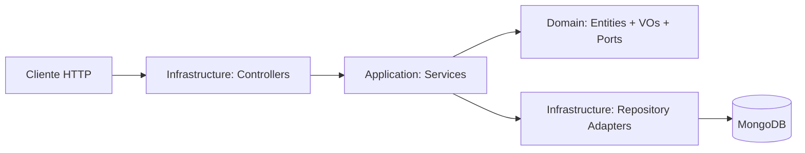

# CTI Platform MVP

Repositorio del TFM orientado a ciberinteligencia (CTI), preparado como workspace con `pnpm`. Contiene el backend (API REST NestJS) y el frontend (Next.js).

## Índice

1. [Objetivo](#objetivo)
2. [Stack tecnológico](#stack-tecnológico)
3. [Arquitectura backend](#arquitectura-backend)
4. [Estado actual](#estado-actual)
5. [Modelo de dominio](#modelo-de-dominio)
6. [Estructura de carpetas](#estructura-de-carpetas)
7. [Configuración de entorno](#configuración-de-entorno)
8. [Ejecución local](#ejecución-local)
9. [Ejecución con Docker](#ejecución-con-docker)
10. [Primeros pasos: ingestar datos y probar la aplicación](#primeros-pasos-ingestar-datos-y-probar-la-aplicación)
11. [API — Swagger](#api--swagger)
12. [Health check](#health-check)
13. [Ingesta de bundles STIX 2.1](#ingesta-de-bundles-stix-21)
14. [Tests](#tests)
15. [CI](#ci)

## Objetivo

Desarrollar una plataforma mantenible y testeable para gestionar inteligencia de amenazas en el MVP, con una base técnica sólida para evolucionar.

En esta fase:

- El foco funcional está en los contextos `Threat`, `Cyber` y `Reporting` (STIX 2.1).
- Autenticación completa: registro/login local con JWT y login con Google OAuth2.
- Se prioriza una arquitectura clara y desacoplada entre dominio y adaptadores.
- Backend y frontend operan como aplicaciones separadas en un monorepo pnpm.

## Stack tecnológico

### Backend

- Node.js 24 + pnpm
- NestJS + TypeScript
- SWC (build y tests)
- MongoDB + Mongoose
- ESLint + Prettier (basado en _strict type checking_ y _stylistic_ de TypeScript ESLint)
- Jest + `@swc/jest` + Supertest + `mongodb-memory-server`
- Docker + Docker Compose

### Frontend

- Node.js 24 + pnpm
- Next.js 16 + React 19 + TypeScript
- App Router + Turbopack (dev) + React Compiler
- Tailwind CSS v4 + shadcn/ui (base-nova)
- TanStack Query (data fetching con caché)
- ESLint (next/core-web-vitals + next/typescript) + Prettier
- Vitest + React Testing Library
- Playwright (E2E)

## Arquitectura backend

Se aplica arquitectura hexagonal pragmática por contextos:

- **Domain**: modelo y reglas de negocio puras.
- **Application**: servicios por entidad y orquestación.
- **Infrastructure**: controladores HTTP, repositorios y persistencia.

La separación entre dominio y persistencia es **intencional**: el dominio no depende de Nest ni de Mongoose, y la persistencia se modela en documentos específicos.

Esto evita acoplamiento tecnológico y facilita la evolución del sistema.



## Estado actual

### Backend

- Endpoints + Swagger (`/api`).
- `GET /health` con estado de DB en contexto `shared`.
- Capa de dominio `shared` con SROs (`Relationship`, `Sighting`) y VOs transversales STIX.
- Contexto `Threat` completo: 5 entidades (`ThreatActor`, `Campaign`, `Incident`, `AttackPattern`, `Indicator`), servicios de lectura, repositorios Mongoose, controladores REST con paginación, filtrado y ordenación.
- Contexto `Cyber` completo: 12 SDOs técnicos STIX 2.1 (`Malware`, `Tool`, `Vulnerability`, `InfrastructureEntity`, `IntrusionSet`, `Identity`, `Location`, `CourseOfAction`, `Note`, `Opinion`, `MalwareAnalysis`, `ObservedData`), persistencia completa, servicios read-only, registrados en `StixRefResolver` y `BundleIngestionService`.
- Contexto `Reporting` completo: entidad `Report` STIX 2.1, servicios de lectura, repositorio Mongoose y endpoints REST (`GET /reports`, `GET /reports/:id`) integrados en el detalle enriquecido cross-context.
- Detalle enriquecido (`EnrichedDetail<T>`): objetos relacionados resueltos cross-context + sightings. `DetailEnricher` incluye una segunda pasada para devolver también las relaciones entre nodos periféricos (no solo las del centro).
- `POST /ingestion/bundles`: ingesta manual de bundles STIX 2.1 con soporte de 20 tipos, idempotente por `domainId`.
- Contexto `Auth` completo: `POST /auth/register`, `POST /auth/login` (Passport local + JWT), `GET /auth/google` + `GET /auth/google/callback` (OAuth2), `GET /auth/me`, `POST /auth/logout`. Bcryptjs 12 rounds. `JwtAuthGuard` protege `POST /ingestion/bundles`.
- Suite de tests unitarios de dominio + application + repositorios + e2e en verde.

### Frontend

- Identidad visual: IBM Plex Sans/Mono + paleta corporativa (`#CF4931` primary, `#EDE9E3` bg, `#092028` sidebar) mapeada a tokens shadcn/ui. Tema claro/oscuro.
- TanStack Query + API client base con tipado de respuestas paginadas.
- Feature `home/`: dashboard principal (`/` redirige a `/home`) con tabs `Overview` y `Threat Domain`, KPIs globales y visualización geoespacial.
- Feature `incidents/`: catálogo paginado + vista detalle con 5 tabs (Executive Summary, Network Analysis, Artifacts & IOCs, Map, Audit & Timeline). Exportación JSON y PDF. Conectado al backend real.
- Feature `campaigns/`: catálogo paginado + vista detalle con 5 tabs. Exportación JSON y PDF. Conectado al backend real.
- Feature `threat-actors/`: catálogo paginado + vista detalle con 4 tabs (Actor Overview, Cyber, Info-Ops, Hybrid Graph). Exportación JSON y PDF. Grafo híbrido con 3 clusters d3-force. Conectado al backend real.
- Feature `reports/`: catálogo paginado + vista detalle con 7 tabs (Datos, Resumen, Actores, Mapa, Targets, Artefactos, Grafo). Exportación JSON y PDF.
- Feature `threat-domain/`: vista unificada con pestañas All / Incidents / Campaigns / Threat Actors / Attack Patterns. Filtro cruzado por ATT&CK e Intrusion Set.
- Feature `cyber-domain/`: vista unificada con pestañas All / Malware / Tools / Vulnerabilities / Intrusion Sets y detalles enriquecidos por entidad (`/malware/[id]`, `/tools/[id]`, `/vulnerabilities/[id]`, `/intrusion-sets/[id]`) con exportación JSON STIX + PDF.
- Feature `ingestion/`: panel lateral (Sheet) para ingestar bundles STIX 2.1 desde la UI. Requiere sesión activa.
- Autenticación completa: páginas `/login` y `/register` en route group `(public)/`, `proxy.ts` de protección de rutas, Route Handlers BFF en `/api/auth/` (login, register, logout, me, google, callback), cookie httpOnly `auth_token`. Dropdown de usuario en `AppHeader`.
- Capa `shared/` con componentes, tabs, utilidades y tipos reutilizables: `EntityCatalog`, `EntityCard`, `EntityListRow`, `DetailPageHeader`, `EntityInfoCard`, `NetworkGraphTab` (d3-force + ReactFlow), `ExecutiveSummaryTab`, `ArtifactsTab`, `AnalysisTab`, `MapTab` (MapLibre + react-map-gl), `TimelineTab`, `DetailSidePanel`, `SectionTitle`, `SectionCard`, `ObservationWindow`, `SightingCount`, `EmptyState`, `TlpBadge`, `ConfidenceBadge`, `CatalogFiltersPanel`, `CvssScoreWidget`, `ExternalReferencesSection`, `KillChainPhaseChips`, estados de carga/error, etc.
- Tests E2E Playwright para todos los features (catálogo + detalle sobre datos reales). Suite de autenticación (login, register, logout).
- Dockerfile multi-stage (development + production con standalone output).

## Modelo de dominio

### Shared (transversal)

- **Entidades SRO**: `Relationship`, `Sighting`.
- **Value Objects**: `TLP`, `AttackMotivation`, `ResourceLevel`, `RelationshipType`, `KillChainPhase`, `ExternalReference`.
- **Puertos**: `RelationshipRepository`, `SightingRepository`.
- **Persistencia**: `RelationshipDocument`, `SightingDocument`.

### Threat

- **Entidades**: `ThreatActor`, `Campaign`, `Incident`, `AttackPattern`, `Indicator`.
- **Value Objects**: `IocType`, `IndicatorType`, `PatternType`, `ThreatActorType`, `ThreatActorRole`, `ThreatActorSophistication`.
- **Puertos**: repositorio por entidad.
- **Persistencia**: documento Mongoose por entidad.

### Cyber

- **Entidades**: `Malware`, `Tool`, `Vulnerability`, `InfrastructureEntity`, `IntrusionSet`, `Identity`, `Location`, `CourseOfAction`, `Note`, `Opinion`, `MalwareAnalysis`, `ObservedData`.
- **Value Objects**: `MalwareType`, `ToolType`, `InfrastructureType`, `IdentityClass`, `OpinionValue`, `Region`, `MalwareAnalysisResult`.
- **Puertos**: repositorio por entidad.
- **Persistencia**: documento Mongoose por entidad.

### Reporting

- **Entidades**: `Report`.
- **Value Objects**: `ReportType`.
- **Puertos**: `ReportRepository`.
- **Persistencia**: `ReportDocument`.

## Estructura de carpetas

### Backend

```text
backend/src/
    main.ts                                      # Bootstrap (pipes globales, swagger, CORS, puerto)
    app.module.ts                                # Módulo raíz (configuración, DB, módulos de contexto)
    config/                                      # Configuración tipada de aplicación y base de datos

    contexts/
        shared/
            application/dtos/                    # DTOs reutilizables (paginación, StixBundleDto)
            application/services/                # RelationshipService, SightingService, StixMapper, BundleIngestionService, StixRefResolver, DetailEnricher
            domain/entities/                     # Entidades SRO (Relationship, Sighting)
            domain/value-objects/                # VOs transversales STIX
            domain/ports/                        # Puertos de repositorio SRO
            infrastructure/controllers/          # Endpoints transversales (health, ingestion)
            infrastructure/persistence/          # Schemas Mongoose + repositorios SRO

        threat/
            domain/                              # Entidades, VOs y puertos del dominio Threat
            application/                         # DTOs, servicios, StixRefResolver, DetailEnricher
            infrastructure/                      # Controladores REST + persistencia Mongoose

        cyber/
            domain/                              # SDOs técnicos STIX 2.1, VOs y puertos
            application/services/                # Servicios read-only (findById por entidad)
            infrastructure/persistence/          # Schemas Mongoose + repositorios

        reporting/
            domain/                              # Entidad Report, VOs y puertos
            application/services/                # Servicio read-only de reportes
            infrastructure/                      # Controladores REST + persistencia Mongoose

        auth/
            domain/entities/                     # User entity
            application/dtos/                    # LoginDto, RegisterDto
            application/services/                # AuthService, UserService
            infrastructure/controllers/          # AuthController
            infrastructure/persistence/          # UserDocument schema + UserMongooseRepository
            infrastructure/guards/               # JwtAuthGuard, LocalAuthGuard
            infrastructure/strategies/           # JwtStrategy, LocalStrategy, GoogleStrategy
            infrastructure/auth.module.ts
```

### Frontend

```text
frontend/src/
    app/
        layout.tsx                               # Layout raíz con providers, fuentes, metadata
        globals.css                              # Tema + tokens shadcn/ui (OKLCH)
        (authenticated)/                         # Route group con layout completo (sidebar + header)
            layout.tsx
            home/                                # Dashboard principal
            incidents/                           # Catálogo y detalle de incidentes
            campaigns/                           # Catálogo y detalle de campañas
            threat-actors/                       # Catálogo y detalle de actores de amenaza
            reports/                             # Catálogo y detalle de informes
            threat-domain/                       # Vista unificada con pestañas por tipo
            cyber-domain/                        # Vista unificada del dominio cyber
        (public)/                                # Route group sin sidebar (login, registro)
            login/
            register/
        api/auth/                                # Route Handlers BFF (login, register, logout, me, google, callback)
        api/ingestion/                           # Route Handler proxy para ingesta protegida
    components/ui/                               # Componentes shadcn/ui (autogenerados)
    features/
        dashboard/                               # Dashboard Home (Overview + Threat Domain tab)
        incidents/                               # API hooks, tipos y componentes de incidentes
        campaigns/                               # API hooks, tipos y componentes de campañas
        cyber-domain/                            # Vista unificada de catálogos cyber
        malware/                                 # Detalle de malware
        tools/                                   # Detalle de tools
        vulnerabilities/                         # Detalle de vulnerabilities
        intrusion-sets/                          # Detalle de intrusion sets
        threat-actors/                           # API hooks, tipos y componentes de actores
        reports/                                 # API hooks, tipos y componentes de informes
        ingestion/                               # Sheet de ingesta de bundles STIX
        auth/                                    # API adapters, hooks (use-login, use-logout, use-register), login-form
        threat-domain/                           # Vista unificada con pestañas por tipo de entidad
    shared/
        components/                              # Componentes reutilizables (EntityCatalog, tabs, DetailPageHeader, badges, estados, AppSidebar, AppHeader…)
        components/tabs/                         # Tabs compartidas (ExecutiveSummary, NetworkGraph, Artifacts, Analysis, Map, Timeline)
        hooks/                                   # Hooks transversales (useTheme, useDetailTab, useEntityPageTitle)
        lib/                                     # stix.ts, export-utils.ts (exportToJson, exportToPdf)
        types/                                   # entity.ts (EntityBase, EntityDetail<T>, SightingItem…)
    providers/
        query-provider.tsx                       # TanStack Query provider
        page-title-context.tsx                   # Contexto de título de página
        auth-context.tsx                         # AuthProvider, useAuth()
    proxy.ts                                     # Protección de rutas autenticadas
```

## Configuración de entorno

Usa `.env` en la raíz del repositorio como fuente única de configuración. Toma como base `.env.example`.

Las variables se consumen mediante configuración tipada con espacios de nombres (`app.*`, `database.*`) — evita acceder a variables sueltas del entorno y facilita escalar la configuración.

| Variable               | Descripción                                        | Default |
| ---------------------- | -------------------------------------------------- | ------- |
| `PORT`                 | Puerto del backend                                 | `3000`  |
| `NODE_ENV`             | Entorno de ejecución                               | —       |
| `CORS_ORIGIN`          | Origen permitido para CORS                         | —       |
| `MONGODB_URI`          | URI de MongoDB para ejecución local                | —       |
| `API_URL`              | URL del backend para el proxy del frontend (local) | —       |
| `MONGODB_URI_DOCKER`   | URI de MongoDB con hostname Docker (`mongo`)       | —       |
| `API_URL_DOCKER`       | URL del backend con hostname Docker (`backend`)    | —       |
| `JWT_SECRET`           | Secreto de firma para tokens JWT                   | —       |
| `JWT_EXPIRES_IN`       | Duración del token JWT                             | `7d`    |
| `GOOGLE_CLIENT_ID`     | Client ID de OAuth2 Google                         | —       |
| `GOOGLE_CLIENT_SECRET` | Client Secret de OAuth2 Google                     | —       |
| `GOOGLE_CALLBACK_URL`  | Callback OAuth2 Google en backend                  | —       |

## Ejecución local

Necesita levantar Docker en modo Desarrollo.

```bash
pnpm install          # desde la raíz del workspace
```

### Scripts desde la raíz

| Scope     | Comando                                                   | Acción                              |
| --------- | --------------------------------------------------------- | ----------------------------------- |
| Workspace | `pnpm build` / `pnpm lint` / `pnpm test`                  | Todas las apps en paralelo          |
| Backend   | `pnpm backend:start:dev`                                  | Backend con hot reload              |
| Backend   | `pnpm backend:build` / `backend:lint` / `backend:test`    | Build, lint, tests unitarios        |
| Backend   | `pnpm backend:test:e2e`                                   | Tests e2e backend (mongodb-memory)  |
| Frontend  | `pnpm frontend:dev`                                       | Frontend con Turbopack              |
| Frontend  | `pnpm frontend:build` / `frontend:lint` / `frontend:test` | Build, lint, tests unitarios Vitest |
| Frontend  | `pnpm frontend:test:e2e`                                  | Tests Playwright E2E                |

### Scripts desde cada carpeta

```bash
# Backend
cd backend && pnpm start:dev

# Frontend
cd frontend && pnpm dev
```

## Ejecución con Docker

El proyecto mantiene dos ficheros Docker Compose según el entorno:

### Desarrollo (`docker-compose.dev.yml`)

Solo levanta **MongoDB**. Backend y frontend se arrancan localmente con hot reload:

```bash
# 1. Levantar MongoDB
docker compose -f docker-compose.dev.yml up -d

# 2. En terminales separadas (o en paralelo):
pnpm backend:start:dev
pnpm frontend:dev
```

> El `.env` local ya apunta a `MONGODB_URI=mongodb://localhost:27017/...` y a `API_URL=http://localhost:3000`.

### Producción (`docker-compose.yml`)

Levanta los tres servicios (backend, frontend y MongoDB) en contenedores. Requiere un `.env` con las variables `*_DOCKER`:

```bash
docker compose -f docker-compose.yml up --build
```

Servicios una vez activos:

| Servicio | URL                         |
| -------- | --------------------------- |
| Frontend | `http://localhost:3001`     |
| Backend  | `http://localhost:3000`     |
| Swagger  | `http://localhost:3000/api` |
| MongoDB  | `localhost:27017`           |

## Primeros pasos: ingestar datos y probar la aplicación

La base de datos arranca vacía. Para ver datos en la UI es necesario ingestar el bundle de prueba incluido en el repositorio.

### 1. Arrancar el entorno

```bash
# Opción A — desarrollo local
docker compose -f docker-compose.dev.yml up -d   # MongoDB
pnpm backend:start:dev                             # Backend en :3000
pnpm frontend:dev                                  # Frontend en :3001

# Opción B — producción Docker
docker compose -f docker-compose.yml up --build
```

### 2. Crear una cuenta y autenticarse

Navega a `http://localhost:3001/register` para crear una cuenta con email, contraseña y nombre.

Una vez autenticado, usa el panel **Ingest Bundle** en la barra lateral para cargar el archivo `docs/data-sample.json`.

> Alternativamente, con un token Bearer obtenido de `POST /auth/login`:
>
> ```bash
> curl -X POST http://localhost:3000/ingestion/bundles \
>   -H "Content-Type: application/json" \
>   -H "Authorization: Bearer <token>" \
>   --data-binary @docs/data-sample.json
> ```

La respuesta incluye un resumen `{ total, processed, skipped, failed }`. Solo `marking-definition` se cuenta como `skipped`; el resto se procesa. La ingesta es **idempotente**.

### 3. Navegar la aplicación

- Frontend: `http://localhost:3001`
- Swagger (explorar la API): `http://localhost:3000/api`

La ingesta es **idempotente**: ejecutarla varias veces no crea duplicados.

## API — Swagger

La documentación interactiva completa de todos los endpoints está disponible en:

```
http://localhost:3000/api
```

Incluye esquemas de request/response, parámetros de paginación, filtros y ejemplos.

---

## Health check

`GET /health` devuelve el estado del servicio:

```json
{
  "status": "ok",
  "timestamp": "2026-05-12T10:00:00.000Z",
  "database": "up"
}
```

## Ingesta de bundles STIX 2.1

**Endpoint:** `POST /ingestion/bundles`

Carga manualmente un bundle STIX 2.1 completo.

- Acepta un body con `type = "bundle"`, `id` y un array `objects` no vacío.
- Soporta **20 tipos** de los dominios implementados:

  | Dominio   | Tipos soportados                                                                                                                                                          |
  | --------- | ------------------------------------------------------------------------------------------------------------------------------------------------------------------------- |
  | Threat    | `threat-actor`, `campaign`, `incident`, `attack-pattern`, `indicator`                                                                                                     |
  | Cyber     | `malware`, `tool`, `vulnerability`, `infrastructure`, `intrusion-set`, `identity`, `location`, `course-of-action`, `note`, `opinion`, `malware-analysis`, `observed-data` |
  | Reporting | `report`                                                                                                                                                                  |
  | Shared    | `relationship`, `sighting`                                                                                                                                                |

- Los tipos no soportados (`marking-definition`, …) se ignoran sin abortar la ingesta (`skipped`).
- Cada objeto se persiste con semántica de **upsert idempotente** por `domainId`: si ya existe, se actualizan los campos mutables y se preserva el `createdAt` original del bundle STIX.
- La respuesta devuelve `{ total, processed, skipped, failed }`.
- El endpoint está protegido con `JwtAuthGuard`. Es necesario incluir el header `Authorization: Bearer <token>`.

## Tests

### Backend

```bash
pnpm backend:test          # tests unitarios (Jest + SWC)
pnpm backend:test:e2e      # tests e2e (mongodb-memory-server, Supertest)
```

Suite completa en verde: tests unitarios de dominio, application, repositorios y tests e2e de los endpoints HTTP.

### Frontend

```bash
pnpm frontend:test         # tests unitarios (Vitest + React Testing Library)
pnpm frontend:test:e2e     # tests Playwright E2E
```

Los tests E2E requieren que backend y frontend estén activos. El `globalSetup` de Playwright:

1. Registra el usuario de prueba `e2e@cti-platform.test`.
2. Ingesta el bundle de `docs/data-sample.json` (autenticado con JWT).
3. Guarda el estado de autenticación en `e2e/.auth/state.json` para que todos los tests arranquen con sesión iniciada.

Specs E2E disponibles: `home`, `incidents`, `campaigns`, `threat-actors`, `reports`, `threat-domain`, `cyber-domain`, `auth`.

## CI

El pipeline de CI ejecuta esta secuencia:

1. `pnpm lint`
2. `pnpm test`
3. `pnpm backend:test:e2e`
4. `pnpm build`

Decisión actual del proyecto:

- **Sí se ejecutan en CI** los tests E2E de backend (Jest + Supertest + `mongodb-memory-server`).
- **No se ejecutan en CI** los tests E2E de frontend (Playwright), porque son pesados, lentos e inestables en pipeline.
- Los E2E de frontend se mantienen para ejecución local (`pnpm frontend:test:e2e`) antes de merge cuando aplique.

Para los E2E de backend en CI **no hace falta levantar Docker**: usan `mongodb-memory-server` y no dependen de servicios externos del stack.
