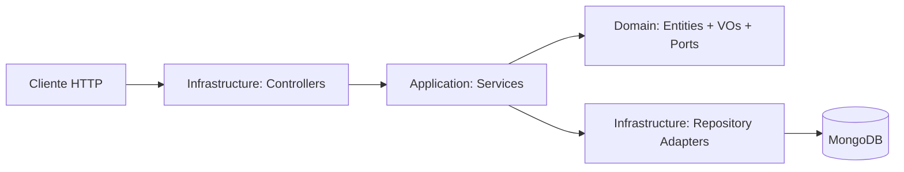

# CTI Platform MVP

Repositorio del TFM orientado a ciberinteligencia (CTI), preparado como workspace con `pnpm` para convivir con varias aplicaciones. Contiene el backend (API REST NestJS) y el frontend (Next.js).

## Objetivo

Desarrollar una plataforma mantenible y testeable para gestionar inteligencia de amenazas en el MVP, con una base técnica sólida para evolucionar.

En esta fase:

- No se implementa autenticación.
- El foco funcional está en los contextos `Threat` y `Cyber` (SDOs técnicos STIX 2.1).
- Se prioriza una arquitectura clara y desacoplada entre dominio y adaptadores.
- Backend y frontend operan como aplicaciones separadas en un monorepo pnpm.

## Stack tecnológico

### Backend

- Node.js 24 + pnpm
- NestJS + TypeScript
- SWC (build y tests)
- MongoDB + Mongoose
- ESLint + Prettier (basado en _strict type checking_ y _stylistic_ de TypeScript ESLint)
- Jest + `@swc/jest` + Supertest + `mongodb-memory-server`
- Docker + Docker Compose

### Frontend

- Node.js 24 + pnpm
- Next.js 16 + React 19 + TypeScript
- App Router + Turbopack (dev) + React Compiler
- Tailwind CSS v4 + shadcn/ui (base-nova)
- TanStack Query (data fetching con cache)
- ESLint (next/core-web-vitals + next/typescript) + Prettier
- Vitest + React Testing Library + jsdom
- Playwright (E2E local, no en CI)

## Arquitectura backend

Se aplica arquitectura hexagonal pragmática por contextos:

- **Domain**: modelo y reglas de negocio puras.
- **Application**: servicios por entidad y orquestación.
- **Infrastructure**: controladores HTTP, repositorios y persistencia.



La separación entre dominio y persistencia es **intencional**: el dominio no depende de Nest ni de Mongoose, y la persistencia se modela en documentos específicos. Esto evita acoplamiento tecnológico y facilita evolución del sistema.

## Estado actual

Implementado:

- Bootstrap Nest + Swagger (`/api`).
- Endpoint `GET /health` en contexto `shared` con estado de DB.
- Capa de dominio compartida (`shared`) con SROs (Relationship, Sighting) y VOs transversales STIX.
- Modelo de dominio `Threat` con propiedades comunes STIX 2.1 (entidades, value objects y puertos).
- Schemas Mongoose espejo del dominio `Threat`.
  - Servicios de lectura de `Threat` (catálogo, detalle, listado de Indicators).
- Repositorios concretos Mongoose de `Threat` y wiring completo de `ThreatModule`.
- Controladores REST de `Threat` para catálogo por entidad, detalle e Indicators.
- Detalle enriquecido (`EnrichedDetail<T>`) con objetos relacionados resueltos y sightings.
- Contrato HTTP validado para filtrado, ordenación y paginación en catálogo Threat e Indicators.
- IDs de dominio en formato STIX `type--uuid` en las 17 entidades.
- Modelo de dominio `Cyber` con 10 SDOs técnicos STIX 2.1, 6 VOs nuevos, persistencia completa, 10 servicios read-only y `CyberModule` wired (sin controllers).
- Servicios de resolución cross-context: `StixRefResolver` (despacho por prefijo STIX) y `DetailEnricher` (orquestación de enriquecimiento).
- Servicios SRO en Shared: `RelationshipService` y `SightingService`.
- Ingesta manual de bundles STIX 2.1 mediante `POST /ingestion/bundles`, con mapeo de 17 tipos soportados y respuesta de resumen (`total`, `processed`, `skipped`, `failed`).
- Persistencia idempotente por `domainId` mediante `save()` en servicios y repositorios, usando upsert atómico y preservando `createdAt` cuando viene informado en el STIX original.
- Suite de tests unitarios de dominio + application + integración de repositorios + e2e en verde.

Frontend:

- Bootstrap Next.js 16 con App Router, Tailwind CSS v4, shadcn/ui, React Compiler, Turbopack.
- Identidad visual UMU aplicada: IBM Plex Sans/Mono + paleta corporativa mapeada a tokens shadcn/ui.
- TanStack Query provider + API client base con tipado de respuestas paginadas.
- ESLint + Prettier configurados en consistencia con el backend.
- Vitest + React Testing Library con test de humo.
- Playwright configurado para E2E local con smoke test.
- Dockerfile multi-stage (development + production con standalone output).

Estructura de workspace:

- Backend activo en `backend/`.
- Frontend activo en `frontend/`.
- Raíz con aliases para operar el backend y frontend sin cambiar de directorio.
- CI única en raíz con jobs paralelos para backend y frontend.

Pendiente (siguiente fase):

- Implementación del frontend: páginas funcionales que consuman la API REST del backend.
- Controladores REST para el contexto Cyber (cuando la UI lo requiera).
- Ingesta automatizada (feeds STIX, TAXII).

## API expuesta actualmente

### Threat

- `GET /threat-actors`
- `GET /threat-actors/:id`
- `GET /campaigns`
- `GET /campaigns/:id`
- `GET /incidents`
- `GET /incidents/:id`
- `GET /attack-patterns`
- `GET /attack-patterns/:id`
- `GET /indicators`

### Health

- `GET /health`

### Ingestion

- `POST /ingestion/bundles`

## Contrato de consulta del MVP

### Catálogo Threat

- Paginación: `page`, `limit`
- Filtros: `name`, `tlp`
- Sort: `sortBy`, `sortOrder`
- Campos de ordenación permitidos: `createdAt`, `updatedAt`, `name`

### Indicators

- Paginación: `page`, `limit`
- Filtros: `type`, `value`, `name`, `tlp`
- Sort: `sortBy`, `sortOrder`
- Campos de ordenación permitidos: `createdAt`, `updatedAt`, `value`, `type`

## Health operativo del MVP

`GET /health` devuelve:

- estado general del servicio (`ok` o `degraded`)
- timestamp de la comprobación
- estado de la conexión a MongoDB (`up` o `down`)

## Ingesta manual de bundles STIX 2.1

El backend expone `POST /ingestion/bundles` para cargar manualmente un bundle STIX 2.1 completo.

- Acepta un DTO con `type = bundle`, `id` y un array `objects` no vacío.
- Soporta los 17 tipos del dominio implementado (`Threat`, `Cyber` y SROs de `Shared`).
- Los tipos desconocidos se ignoran sin abortar la ingesta.
- Cada objeto se persiste mediante `save()` con semántica de upsert idempotente por `domainId`.
- Si el objeto ya existe, se actualizan los campos mutables y se preserva el `createdAt` original de STIX cuando venía en el payload inicial.
- La respuesta devuelve un resumen con `total`, `processed`, `skipped` y `failed`.

## Modelo de dominio (implementado)

### Shared (transversal)

- **Entidades SRO**: `Relationship`, `Sighting`.
- **Value Objects / enums compartidos**: `TLP`, `AttackMotivation`, `ResourceLevel`, `RelationshipType`.
- **Value Objects / interfaces compartidos**: `KillChainPhase`, `ExternalReference`.
- **Puertos de repositorio**: `RelationshipRepository`, `SightingRepository`.
- **Persistencia (Mongoose)**: `RelationshipDocument`, `SightingDocument`.

### Threat

- **Entidades**: `ThreatActor`, `Campaign`, `Incident`, `AttackPattern`, `Indicator`.
- **Value Objects / enums propios**: `IocType`, `IndicatorType`, `PatternType`, `ThreatActorType`, `ThreatActorRole`, `ThreatActorSophistication`.
- **Puertos de repositorio**: `ThreatActorRepository`, `CampaignRepository`, `IncidentRepository`, `AttackPatternRepository`, `IndicatorRepository`.
- **Persistencia (Mongoose)**: `ThreatActorDocument`, `CampaignDocument`, `IncidentDocument`, `AttackPatternDocument`, `IndicatorDocument`.

### Cyber

- **Entidades**: `Malware`, `Tool`, `Vulnerability`, `InfrastructureEntity`, `IntrusionSet`, `Identity`, `Location`, `CourseOfAction`, `Note`, `Opinion`.
- **Value Objects / enums propios**: `MalwareType`, `ToolType`, `InfrastructureType`, `IdentityClass`, `OpinionValue`, `Region`.
- **Puertos de repositorio**: `MalwareRepository`, `ToolRepository`, `VulnerabilityRepository`, `InfrastructureEntityRepository`, `IntrusionSetRepository`, `IdentityRepository`, `LocationRepository`, `CourseOfActionRepository`, `NoteRepository`, `OpinionRepository`.
- **Persistencia (Mongoose)**: documentos Mongoose espejo por cada entidad.

## Estructura de carpetas backend

```text
backend/src/
	main.ts                                      # Bootstrap (pipes globales, swagger, CORS, puerto)
	app.module.ts                                # Módulo raíz (configuración, DB, módulos de contexto)
	config/                                      # Configuración tipada de aplicación y base de datos

	contexts/
		shared/
			application/dtos/                        # DTOs reutilizables (p. ej. paginación, StixBundleDto)
			application/services/                    # RelationshipService, SightingService, StixMapper, BundleIngestionService
			domain/entities/                         # Entidades SRO (Relationship, Sighting)
			domain/value-objects/                    # VOs transversales STIX (TLP, RelationshipType...)
			domain/ports/                            # Puertos de repositorio SRO
			infrastructure/controllers/              # Endpoints transversales (p. ej. health, ingestion)
			infrastructure/persistence/schemas/      # Schemas Mongoose SRO
			infrastructure/persistence/repositories/ # Repositorios Mongoose SRO

		threat/
			domain/entities/                         # Entidades del dominio Threat
			domain/value-objects/                    # Enums y tipos de valor del dominio
			domain/ports/                            # Contratos (puertos) de repositorio

			application/dtos/                        # DTOs de entrada/salida + EnrichedDetail
			application/services/                    # Servicios + StixRefResolver + DetailEnricher

			infrastructure/controllers/              # Controladores REST de Threat
			infrastructure/persistence/schemas/      # Schemas Mongoose (documentos)
			infrastructure/persistence/repositories/ # Implementaciones concretas de puertos

		cyber/
			domain/entities/                         # SDOs técnicos STIX 2.1
			domain/value-objects/                    # Enums STIX del dominio Cyber
			domain/ports/                            # Contratos (puertos) de repositorio

			application/services/                    # servicios read-only (findById)

			infrastructure/persistence/schemas/      # Schemas Mongoose (documentos)
			infrastructure/persistence/repositories/ # Implementaciones concretas de puertos
```

## Estructura de carpetas frontend

```text
frontend/src/
	app/
		layout.tsx                               # Layout raíz con providers, fuentes UMU, metadata
		page.tsx                                 # Página principal (placeholder)
		globals.css                              # Tema UMU + tokens shadcn/ui (OKLCH)
	components/
		ui/                                      # Componentes shadcn/ui (autogenerados)
	lib/
		utils.ts                                 # Utilidad cn() de shadcn
		api-client.ts                            # Cliente API base (fetch + tipado)
	providers/
		query-provider.tsx                       # TanStack Query provider
```

## Configuración de entorno

Usa `.env` en la raíz del repositorio para ejecución local y toma como base `.env.example`.

### Decisión técnica sobre configuración

Se usa configuración tipada con espacios de nombres (`app.*` y `database.*`) en lugar de acceder directamente a variables sueltas del entorno. Por eso en el código aparecen claves como `app.port` y `database.uri`: mejora la coherencia interna, reduce errores por nombres inconsistentes y facilita escalar la configuración del proyecto con trazabilidad.

Variables actuales:

- `PORT` — Puerto del backend (default: 3000)
- `NODE_ENV` — Entorno de ejecución
- `CORS_ORIGIN` — Origen permitido para CORS
- `MONGODB_URI` — URI de conexión a MongoDB (local)
- `API_URL` — URL interna del backend para el proxy del frontend (local)
- `MONGODB_URI_DOCKER` — URI de MongoDB con hostname Docker (`mongo`)
- `API_URL_DOCKER` — URL del backend con hostname Docker (`app`)

## Ejecución local

```bash
pnpm install
```

La instalación se realiza desde la raíz del workspace.

### Desde la raíz

- Scripts genéricos del workspace: `pnpm build`, `pnpm lint`, `pnpm test`, `pnpm start:dev`
- Scripts específicos del backend: `pnpm backend:build`, `pnpm backend:lint`, `pnpm backend:test`, `pnpm backend:test:e2e`, `pnpm backend:start:dev`
- Scripts específicos del frontend: `pnpm frontend:build`, `pnpm frontend:lint`, `pnpm frontend:test`, `pnpm frontend:dev`

Los scripts genéricos orquestan todas las apps del workspace; los `backend:*` y `frontend:*` operan solo su aplicación respectiva.

### Desde `backend/`

```bash
cd backend
pnpm start:dev
pnpm build
pnpm lint
pnpm test
pnpm test:e2e
```

### Desde `frontend/`

```bash
cd frontend
pnpm dev
pnpm build
pnpm lint
pnpm test
pnpm test:e2e
```

## Docker

El proyecto mantiene dos opciones:

- `docker-compose.dev.yml`: entorno de desarrollo (hot reload y volúmenes).
- `docker-compose.yml`: entorno de ejecución para producción.

### Desarrollo con Docker

```bash
docker compose -f docker-compose.dev.yml up --build
```

### Ejecución tipo producción con Docker

```bash
docker compose -f docker-compose.yml up --build
```

Servicios:

- Backend API: `http://localhost:3000`
- Swagger: `http://localhost:3000/api`
- Frontend: `http://localhost:3001`
- MongoDB: `localhost:27017`
