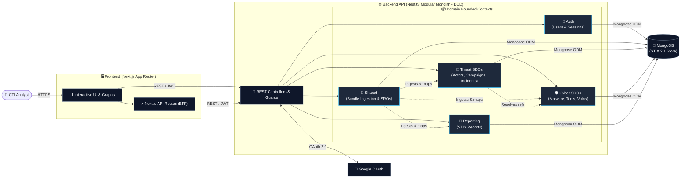
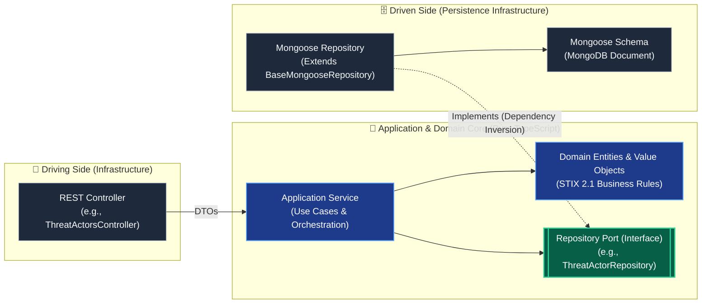

# Cyber Threat Intelligence (CTI) Platform

## 🎯 Project Overview

This project is a comprehensive Cyber Threat Intelligence (CTI) platform built strictly around the **STIX 2.1 (Structured Threat Information Expression)** standard. It enables the ingestion, processing, and visualization of complex cyber threat data, including campaigns, intrusion sets, malware, and attack patterns.

The primary engineering challenge of this platform was handling the deeply interconnected, graph-like nature of STIX 2.1 relationships while maintaining high performance, strict data integrity, and a clean, decoupled architecture.

## 💻 Tech Stack

- **Backend:** TypeScript, Node.js, NestJS
- **Frontend:** Next.js (React), Tailwind CSS
- **Database & Persistence:** MongoDB
- **Architecture:** Domain-Driven Design (DDD), Hexagonal Architecture (Ports & Adapters)
- **QA & Testing:** Jest (Unit/Integration), Vitest, Playwright (E2E)
- **DevOps:** Docker, Docker Compose, GitHub Actions (CI/CD)

## 🧠 Architecture & Engineering Impact

As the sole architect and developer of this platform, I focused on building a maintainable and scalable system capable of parsing heavy data payloads. Key technical achievements include:

- **Strict Domain-Driven Design (DDD):** Architected the backend using Hexagonal Architecture, strictly separating the business logic into distinct Bounded Contexts (`Threat`, `Cyber`, `Reporting`, `Auth`). This ensures that core STIX entities remain completely isolated from infrastructure and delivery mechanisms.
- **Complex Data Ingestion Engine:** Engineered a robust ingestion pipeline (`Bundle Ingestion Service`) capable of processing large STIX 2.1 JSON bundles. The system efficiently parses, validates, and persists hundreds of entities and their complex inter-relationships into MongoDB.
- **NoSQL Data Modeling:** Designed the persistence layer using MongoDB to naturally accommodate the highly flexible and polymorphic nature of STIX 2.1 objects, implementing custom repositories to handle complex document references and queries.
- **Full-Stack End-to-End Delivery:** Developed a responsive, type-safe frontend using Next.js to visualize the threat landscape, bridging the gap between raw backend intelligence and actionable user interfaces.
- **Comprehensive Testing Strategy:** Enforced software quality from day one by implementing unit and integration tests (Jest/Vitest) for backend domain logic, and robust End-to-End (E2E) testing for critical user flows using **Playwright**.

### 🏗️ System & Domain Architecture

The platform's architecture is documented at two levels: the **System & Bounded Contexts Overview** (macro level) and the **Hexagonal Architecture implementation** (micro level inside each module).

#### 1. System & Bounded Contexts Overview



#### 2. Hexagonal Architecture (Ports & Adapters) per Bounded Context

Inside `backend/src/contexts/*`, every module strictly enforces **Dependency Inversion** so the core STIX 2.1 domain logic remains 100% decoupled from NestJS and MongoDB:



## 🚀 Quick Start (Docker)

The platform is fully containerized for easy evaluation and deployment. You can spin up the entire stack using Docker Compose:

```bash
# Copy the example environment variables
cp .env.example .env

# Update required secrets (Google)

# Build and start the services
docker-compose up -d --build
```

---

_If you are a technical lead or recruiter, I encourage you to explore the `backend/src/contexts` directory to review the DDD implementation, specifically how the STIX domain models and ingestion services are isolated using Ports and Adapters._
