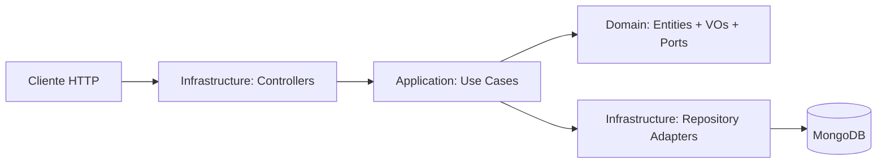

# CTI Platform MVP

Backend del TFM orientado a ciberinteligencia (CTI), inspirado en el buscador de Pulsos de OTX.

## Objetivo

Desarrollar un backend mantenible y testeable para gestionar inteligencia de amenazas en el MVP, con una base técnica sólida para evolucionar en siguientes iteraciones.

En esta fase:

- No se implementa autenticación.
- El foco funcional está en el contexto `Threat`.
- Se prioriza una arquitectura clara y desacoplada entre dominio y adaptadores.

## Stack tecnológico

- Node.js 24 + pnpm
- NestJS + TypeScript
- SWC (build y tests)
- MongoDB + Mongoose
- ESLint + Prettier (basado en _strict type checking_ y _stylistic_ de TypeScript ESLint)
- Jest + `@swc/jest` + Supertest + `mongodb-memory-server`
- Docker + Docker Compose

## Arquitectura

Se aplica arquitectura hexagonal pragmática por contextos:

- **Domain**: modelo y reglas de negocio puras.
- **Application**: casos de uso y orquestación.
- **Infrastructure**: controladores HTTP, repositorios y persistencia.



La separación entre dominio y persistencia es **intencional**: el dominio no depende de Nest ni de Mongoose, y la persistencia se modela en documentos específicos. Esto evita acoplamiento tecnológico y facilita evolución del sistema.

## Estado actual

Implementado:

- Bootstrap Nest + Swagger (`/api`).
- Endpoint `GET /health` extendido en contexto `shared` con estado de DB, conteos por entidad y `lastIngestion: null`.
- Modelo de dominio `Threat` (entidades, value objects y puertos).
- Schemas Mongoose espejo del dominio `Threat`.
- Casos de uso de lectura de `Threat` (catálogo, detalle, listado de IoCs).
- Repositorios concretos Mongoose de `Threat` y wiring completo de `ThreatModule`.
- Controladores REST de `Threat` para catálogo, detalle simple e IoCs.
- Contrato HTTP validado para filtrado, ordenación y paginación en catálogo Threat e IoCs.
- Suite de tests unitarios de dominio + application + integración de repositorios + e2e en verde.

Pendiente (siguiente fase):

- Posibles use-cases overview de detalle enriquecido si la UI requiere respuestas compuestas en una sola llamada.
- Filtros avanzados adicionales más allá del contrato base del MVP.
- Ingesta automatizada.

## API expuesta actualmente

### Threat

- `GET /threat-actors`
- `GET /threat-actors/:id`
- `GET /campaigns`
- `GET /campaigns/:id`
- `GET /incidents`
- `GET /incidents/:id`
- `GET /attack-patterns`
- `GET /attack-patterns/:id`
- `GET /iocs`

### Health

- `GET /health`

## Contrato de consulta del MVP

### Catálogo Threat

- Paginación: `page`, `limit`
- Filtros: `name`, `tlp`
- Sort: `sortBy`, `sortOrder`
- Campos de ordenación permitidos: `createdAt`, `updatedAt`, `name`

### IoCs

- Paginación: `page`, `limit`
- Filtros: `type`, `value`, `tlp`
- Contexto opcional por origen: `sourceType`, `sourceId`
- Sort: `sortBy`, `sortOrder`
- Campos de ordenación permitidos: `createdAt`, `updatedAt`, `value`, `type`

## Health operativo del MVP

`GET /health` devuelve:

- estado general del servicio
- timestamp de la comprobación
- estado de la conexión a MongoDB
- conteos por entidad Threat (`threatActors`, `campaigns`, `incidents`, `attackPatterns`, `iocs`)
- `lastIngestion: null` como placeholder hasta que exista ingesta automatizada

## Modelo de dominio Threat (implementado)

- **Entidades**: `ThreatActor`, `Campaign`, `Incident`, `AttackPattern`, `Ioc`.
- **Value Objects / enums**: `TLP`, `IocType`, `AttackMotivation`, `ThreatActorType`, `ThreatActorRole`, `ThreatActorSophistication`, `ResourceLevel`.
- **Puertos de repositorio**: `ThreatActorRepository`, `CampaignRepository`, `IncidentRepository`, `AttackPatternRepository`, `IocRepository`.
- **Persistencia (Mongoose)**: `ThreatActorDocument`, `CampaignDocument`, `IncidentDocument`, `AttackPatternDocument`, `IocDocument`.

## Estructura de carpetas

```text
src/
	main.ts                                      # Bootstrap (pipes globales, swagger, puerto)
	app.module.ts                                # Módulo raíz (configuración, DB, módulos de contexto)
	config/                                      # Configuración tipada de aplicación y base de datos

	contexts/
		shared/
			application/dtos/                        # DTOs reutilizables (p. ej. paginación)
			domain/                                  # Elementos de dominio transversales
			infrastructure/controllers/              # Endpoints transversales (p. ej. health)

		threat/
			domain/entities/                         # Entidades del dominio Threat
			domain/value-objects/                    # Enums y tipos de valor del dominio
			domain/ports/                            # Contratos (puertos) de repositorio

			application/dtos/                        # DTOs de entrada/salida de casos de uso
			application/use-cases/                   # Casos de uso de Threat

			infrastructure/controllers/              # Controladores REST de Threat
			infrastructure/persistence/schemas/      # Schemas Mongoose (documentos)
			infrastructure/persistence/repositories/ # Implementaciones concretas de puertos
```

## Configuración de entorno

Usa `.env` para ejecución local y toma como base `.env.example`.

### Decisión técnica sobre configuración

Se usa configuración tipada con espacios de nombres (`app.*` y `database.*`) en lugar de acceder directamente a variables sueltas del entorno. Por eso en el código aparecen claves como `app.port` y `database.uri`: mejora la coherencia interna, reduce errores por nombres inconsistentes y facilita escalar la configuración del proyecto con trazabilidad.

Variables actuales:

- `PORT`
- `NODE_ENV`
- `MONGODB_URI`

## Ejecución local

### Instalar dependencias

```bash
pnpm install
```

### Desarrollo

```bash
node --run start:dev
# o
pnpm start:dev
```

### Build y producción

```bash
node --run build
node --run start:prod
# o
pnpm build && pnpm start:prod
```

### Lint y tests

```bash
node --run lint
node --run test
node --run test:e2e
# o
pnpm lint && pnpm test && pnpm test:e2e
```

## Docker

El proyecto mantiene dos opciones:

- `docker-compose.dev.yml`: entorno de desarrollo (hot reload, volumen y puerto debug 9229).
- `docker-compose.yml`: entorno de ejecución para producción.

### Desarrollo con Docker

```bash
docker compose -f docker-compose.dev.yml up --build
```

### Ejecución tipo producción con Docker

```bash
docker compose -f docker-compose.yml up --build
```

Servicios:

- API: `http://localhost:3000`
- Swagger: `http://localhost:3000/api`
- MongoDB: `localhost:27017`
